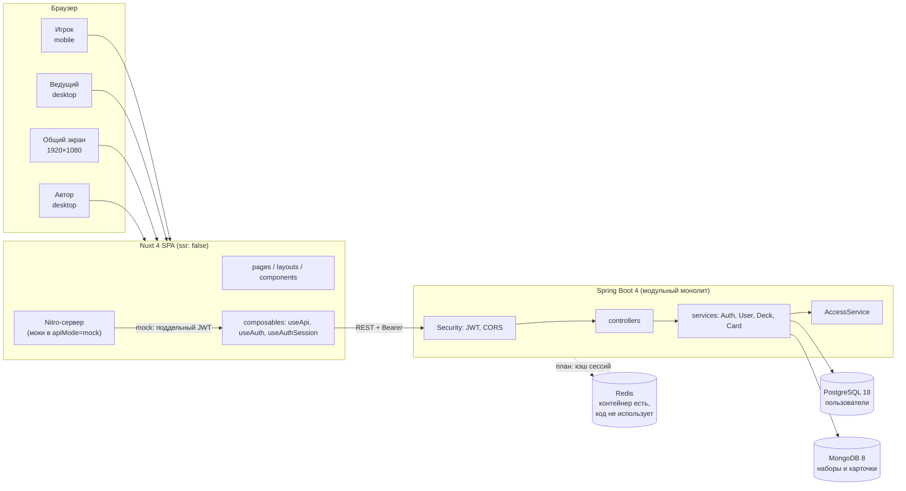
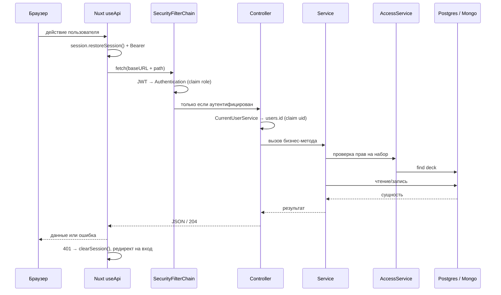

# 67 Cards — единый разбор проекта

**Что это за файл.** Один сквозной документ: зачем существует проект, какие в нём правила игры, как устроены данные, код, безопасность и запуск, что уже работает, а что только запланировано, и где лежат грабли.

**Дата составления:** 27 ноября 2026 года. Составлен по фактическому коду в ветке `dev` (коммит `81978e7`), по документу требований `stage_1/*.odt`, по матрице `planning/REQUIREMENTS.md`, плану `planning/PLAN.md`, ER-модели `ER/generated/ER2.dbml` и дизайн-документу `design/DESIGN.md`.

**Область правды.** Этот файл — навигация и объяснение, а не замена источникам. Требования меняются в
[документе требований](stage_1/), архитектурные решения — в [PLAN.md](planning/PLAN.md), приёмочные
критерии — в [REQUIREMENTS.md](planning/REQUIREMENTS.md), макеты — в [DESIGN.md](design/DESIGN.md).
Если этот разбор расходится с кодом — прав код; если расходится с требованиями — это расхождение,
и оно перечислено в §19.

---

## 0. Как читать этот документ

| У вас есть | Читайте | Итог |
|---|---|---|
| 10 минут | §1, §2, §16 | Понимаете, что за продукт и в какой он стадии |
| 1 час | §1–§12 подряд | Можете осмысленно менять код и не ломать контракты |
| Нужно сделать фичу | §6, §8, §11, §18, §20 | Знаете, где писать, что проверять и что обновить в доках |
| Нужно провести игру | §3, §4, §5 | Понимаете механику и параметры этапов |
| Что-то не сходится | §19 | Видите известные противоречия и что с ними делать |

Термины в этом документе — из требований, не мои. Если слово в кавычках — это доменный термин (§22).

---

## 1. Что это за продукт

**67 Cards** — платформа для проведения интерактивных онлайн-мероприятий: викторин и игр «на несколько человек»,
построенных на собственных наборах карточек. Ведущий собирает сценарий из этапов, запускает игровую сессию,
игроки подключаются по коду с телефона и играют в реальном времени.

Формально это курсовая работа (два автора: Снагин Станислав, Степанов Илья; отсюда `org.ssnagin`, `SN` в именах),
но по требованиям — полноценное приложение уровня продукта: цель роста 5000 платящих пользователей,
целевая одновременная нагрузка 100 игроков суммарно и до 30 в одной комнате.

Три «кита» продукта:

1. **Материалы.** Пользователь ведёт наборы карточек: лицевая/обратная сторона, текст, списки, таблицы,
   изображения. Наборы можно расшаривать и редактировать совместно.
2. **Сценарии.** Мероприятие — это шаблон: упорядоченная последовательность этапов. Этап = одна игровая
   механика (викторина, Своя игра, рынок прогнозов, аукцион, кейс, рулетка) со своими настройками.
3. **Живая сессия.** Запуск мероприятия превращается в сессию: лобби с кодом и QR, этапы, раунды, ответы,
   ставки, баллы, лидерборд, восстановление связи. Всё считается на сервере.

Ключевая продуктовая особенность: **динамический баланс**. Баллы — не просто счётчик правильных ответов.
Лидер получает штраф за каждый новый ответ, отстающие — бонус, а при отрыве выше порога у лидера раз в раунд
бросается кубик: выпало 6 — баланс делится вдвое. Игра «держит» всех в игре (F.3.5–F.3.7, F.5.5).

---

## 2. Словарь домена

Эти слова дальше используются буквально, путать их нельзя — на путанице уже построены отдельные
противоречия в требованиях (см. комментарии в ODT про «игру» и «этап»).

| Термин | Определение |
|---|---|
| **Пользователь** | Зарегистрированный владелец учётной записи. Создаёт материалы, собирает мероприятия, ведёт сессии, выдаёт доступ. |
| **Гость** | Тот, кто проходит по коду комнаты без аккаунта. Guest-режим заложен в требования (F.5.2): игроку регистрация не нужна. |
| **Ведущий** | Пользователь, который управляет конкретной сессией. Не глобальная роль, а `game_sessions.host_user_id`. |
| **Игрок** | Участник конкретной сессии (в целевой модели — `session_players`, включая гостей). |
| **Рабочее пространство** | Область пользователя с его материалами. В модели выражено владением, отдельной таблицы нет. |
| **Набор карточек** | Совокупность карточек («документ»). `card_sets` в целевой модели, `decks` в текущем Mongo-коде. |
| **Карточка** | Минимальная единица контента: две стороны. Одна сторона обычно вопрос, другая — правильный ответ. |
| **Мероприятие** | Шаблон сценария: последовательность этапов + общие настройки. Игроков и результатов не содержит. |
| **Этап** | Один шаг сценария с одной игровой механикой, своими параметрами и при необходимости вопросами. |
| **Игровая сессия** | Конкретный запуск мероприятия в реальном времени: участники, состояние этапов и раундов, ставки, балансы. |
| **Лобби** | Состояние сессии до старта: код/QR, игровые имена, ожидание. |
| **Раунд** | Завершённый фрагмент этапа: один вопрос, лот, прогноз или вращение. В конце определяется результат и меняются балансы. |
| **Лидерборд** | Упорядоченная таблица игроков и их текущих результатов. |
| **Общий экран** | Проекция для проектора/ТВ: только публичная информация, без интерактива. |
| **Динамический баланс** | Набор модификаторов начисления, зависящих от текущей позиции игрока (§5). |

---

## 3. Как это играется: сквозной сценарий

Пример из требований — финальная пара лабораторной по курсу «Информационные системы»:

```text
Лобби
 └── Своя игра (без вариантов ответа)
      └── Рынок прогнозов
           └── Аукцион (3 лота)
                └── Викторина (без вариантов ответа)
                     └── Аукцион (1 лот, внезапный)
                          └── Своя игра (с вариантами)
                               └── Рынок прогнозов
                                    └── Аукцион (2 лота)
```

Роли и их опыт различаются радикально, поэтому интерфейсов фактически три:

| Участник | Устройство | Что видит |
|---|---|---|
| Игрок | смартфон, mobile-first от 320 px | своё имя, баланс, таймер, одно доступное действие, подтверждение приёма, ожидание результата |
| Ведущий | ноутбук 1280–1440 | «пульт»: этап/раунд, таймер, превью общего экрана, список игроков, действия механики, пауза, ручные баллы |
| Общий экран | проектор 1920×1080 | вопрос/лот/колесо, таймер, счётчики принятых действий, ответ после раскрытия, лидерборд |
| Автор | desktop/планшет | конструктор: наборы, редактор карточек, конструктор мероприятия, настройки этапов |

Жёсткие правила живой сессии:

- Игроку **не показывают** количество и типы будущих этапов (F.3.2) и правильный ответ до раскрытия (NF.2.3),
  в том числе при переподключении.
- Ведущий — единственный, кто переключает раунды/этапы, оценивает спорный ответ, фиксирует исход события,
  закрывает аукцион (F.5.3).
- «Завершить раунд» и «Завершить сессию» визуально не взаимозаменяемы (§13, AGENTS.md).
- После фиксации действия менять его нельзя (F.5.8), кроме явно разрешённых случаев: изменение прогноза
  до закрытия рынка, если включена настройка.
- Пауза сохраняет остаток времени; возобновление задаёт новый серверный дедлайн.
- Ручная корректировка баллов — новая запись с причиной и автором, историю не переписываем.

---

## 4. Шесть игровых механик

Это ядро продукта: каждый тип этапа — отдельная механика со своим набором параметров и своим типом раунда.
Формулировки и параметры ниже — из исходного документа требований (раздел «Предлагаемые типы этапов»).

### 4.1. Викторина

Все игроки одновременно отвечают на один вопрос. В начале раунда показывается вопрос, при необходимости
варианты ответа, затем стартует таймер. Каждый игрок отправляет **только один** ответ. Таймер истёк или
все ответили → приём блокируется, раскрывается правильный ответ, начисляются/списываются баллы.

Параметры: базовая стоимость вопроса · показывать ли настройки игры (по каждому пункту отдельно) ·
время на ответ · бонус за скорость · штраф за неправильный ответ · штраф за отсутствие ответа /
ответ по умолчанию.

Варианты: с готовыми вариантами (один верный) и без них (свободный ввод, сравнение после нормализации
регистра и пробелов; спорный ответ оценивает ведущий).

### 4.2. Своя игра

Игровое поле с категориями и вопросами разной стоимости. Перед раундом категорию и стоимость выбирают
(в зависимости от настроек): ведущий, игрок, по очереди игроков или общим голосованием. После показа
вопроса игроки жмут «Готов» — первый нажавший получает право ответа; сервер упорядочивает нажатия
не позднее 100 мс после получения (NF.1.1).

Параметры: наличие вариантов ответа · бонусный коэффициент для режима без вариантов · принцип выбора
вопроса (голосование / ведущий / очередь) · фиксированное время на голосование · штраф за неправильный
ответ (в т.ч. если первый нажавший не ответил — F.4.3).

### 4.3. Рынок прогнозов

Ведущий показывает событие и два взаимоисключающих исхода. Игроки распределяют часть баллов по исходам.
Время вышло → ставки блокируются. Результат известен → **ведущий** выбирает наступивший исход. Банк
раунда распределяется между поставившими на верный исход пропорционально их ставкам (F.4.8).

Параметры: минимальная ставка (фиксированная или % от баланса) · максимальная ставка · настройка
коэффициентов · поведение, если на верный исход никто не поставил (начислить всем / ничего / штраф) ·
возможность изменить ставку до закрытия · видимость общего банка и распределения · время приёма ставок ·
видно ли, кто на что поставил.

Важная деталь: «настройка коэффициентов» в требованиях конфликтует с пропорциональной формулой F.4.8.
В модели принята F.4.8, а коэффициент — расчётный показатель для отображения (§19, п. 2).

### 4.4. Аукцион

Один или несколько лотов: название, описание, изображение, игровой эффект/награда, начальная цена.
Ставка принимается, если она не меньше предыдущей + шаг и не превышает доступного баланса. Торги
закрываются по таймеру (с добавлением времени после последней ставки) или вручную. Победитель — наибольшая
принятая ставка, сумма списывается, эффект лота применяется (F.4.4, F.4.5, F.5.6).

Параметры: количество и порядок лотов · описание и фото каждого · минимальная/начальная цена ·
минимальный шаг · тип шага (линейный, экспоненциальный) · разрешение ничьей/спора (монетка,
камень-ножницы-бумага) · действие при отсутствии ставок (принудительные ставки всех, скип) · формат
торгов (свободный, по очереди) · по времени или по решению ведущего · сколько секунд добавлять после
ставки · что получает победитель.

### 4.5. Кейс

Случайный выбор одного из настроенных исходов. Каждый сектор: название, вероятность (вес), игровой
эффект. Исход определяется **на сервере** и применяется автоматически. Эффекты могут быть
индивидуальными: система подстраивает «+ / −» под текущий баланс игрока.

Параметры: список секторов и модификаторов (есть стандартный набор) · вес каждого · автонастройка
плюс/минус баллов относительно баланса.

### 4.6. Рулетка

Аналог европейской рулетки: сектора с номером, цветом, весом и коэффициентом выплаты. Приём ставок
ограничен по времени, затем колесо крутится, исход определяется на сервере, баллы начисляются/списываются
по типу ставки и коэффициенту.

Параметры: список секторов и модификаторов · вес каждого (по умолчанию 37 секторов 0–36 равновероятны) ·
коэффициент выплаты для каждого типа ставки · минимальная и максимальная ставка.

### 4.7. Импорт карточек

Для «Викторины» и «Своей игры» набор карточек превращается в вопросы (F.3.3). При импорте автор
дописывает неправильные варианты ответов (F.3.4). Импорт создаёт **независимую копию**: правка или удаление
исходной карточки не меняет уже созданное мероприятие и не ломает изображения (PLAN.md, ER2-notes).

---

## 5. Модификаторы: «динамический баланс»

Применяются к мероприятию целиком, по умолчанию включены (требования, раздел «Предлагаемые модификаторы»).

### 5.1. Штраф за лидерство

За каждый новый ответ игрок на 1-м месте получает −15 %, на 2-м −10 %, на 3-м −5 % (настраивается).

### 5.2. Бонус отстающим

За каждый правильный ответ: +50 % за последнее место, +25 % за предпоследнее, +15 % за третье с конца
(настраивается).

### 5.3. Урезание баланса лидера

Если отрыв лидера превышает критический порог, после каждого раунда ему «бросается кубик». Выпало 6 —
баланс делится вдвое. Пример из требований: Петров 8000, Иванов 4000, Сидоров 3500 → Петрову кубик
после каждого раунда.

Требование F.5.5 добавляет зрелищность: анимация броска видна **всем** участникам, с баннером на весь
экран. Но результат уже определён сервером: анимация не может «выбирать» исход (§18).

### 5.4. Как это считается (принятые в модели правила)

Порядок обработки, зафиксированный в PLAN.md и ER2-notes:

1. До начала раунда фиксируются позиции игроков (снимок рейтинга).
2. Считается базовый результат раунда (правильность, стоимость, скорость).
3. К **положительной** награде применяются модификаторы позиции; совпавшие верхний и нижний
   перемножаются.
4. Обновляется рейтинг.
5. Проверяется правило урезания лидера и, если сработало, применяется один раз.

Баллы целые, коэффициенты считаются без двоичной плавающей арифметики, остатки распределения
обрабатываются детерминированно (PLAN.md, «Корректность игры»).

---

## 6. Роли и права

### 6.1. Роли в системе

| Уровень | Кто | Что может |
|---|---|---|
| Аноним | нет токена | только `POST /api/auth/register`, `POST /api/auth/login` |
| `USER` | владелец аккаунта | всё в рамках своих материалов; читать чужие публичные наборы |
| `ADMIN` | зарезервировано (`Role.ADMIN`) | никакой логики в коде пока нет |
| Ведущий | `USER`, ведущий сессию | управление конкретной сессией (в целевой модели) |
| Игрок | гость или `USER` | действия внутри сессии (в целевой модели) |

### 6.2. Правила доступа к материалам (текущий код)

Реализовано в `AccessService` — это единственная точка правды по доступу к наборам:

- **Чтение** (`getDeckForRead`): набор `isPublic == true` читает любой авторизованный; приватный — только владелец.
- **Запись** (`getDeckForWrite`): только владелец.
- **Не найдено** → `404`, **нет прав** → `403`.

### 6.3. Правила доступа из требований (ещё не реализованы)

- Выдача и отзыв доступа к набору другому пользователю, режимы просмотр/редактирование (F.2.5, F.2.6).
- Прямой доступ к файлам чужих карточек запрещён: проверка на бэкенде (NF.2.4).
- Удаление аккаунта удаляет его материалы и отбирает выданные ему права (F.1.4).
- Пользователь не должен получать правильные ответы и будущие этапы в выдаче (NF.2.3, F.3.2) —
  для этого нужны разные проекции состояния для ведущего, игрока и общего экрана (PLAN.md).

---

## 7. Архитектура

### 7.1. Компоненты



### 7.2. Зоны ответственности

| Слой | Технология | Ответственность |
|---|---|---|
| Frontend | Nuxt 4.1, Vue 3.5, TypeScript, Tailwind | экраны, состояние сессии, вызовы API, вся анимация |
| Backend | Spring Boot 4.1.1, Java 25, Spring Security, OAuth2 Resource Server | бизнес-правила, права, расчёты, случайные исходы, время |
| PostgreSQL | 18.6 | учётные записи; в целевой модели — вообще все «надёжные» данные |
| MongoDB | 8 | наборы и карточки (документная структура контента) |
| Redis | 8 | задуман как кэш активных сессий; пока контейнер без потребителя |
| Совместный редактор | Tiptap + Yjs + Hocuspocus (план) | одновременное редактирование карточек |
| Reverse proxy | (на хосте) | HTTPS/WSS, публикация 16768 и 3000 |

### 7.3. Ключевые архитектурные решения (и их причины)

1. **Модульный монолит, а не микросервисы.** Одна команда из двух человек, Raspberry Pi 5 (4 ядра, 6 ГБ):
   отдельный сервис на каждую механику — лишняя эксплуатация. Области внутри монолита разделены пакетами.
2. **SPA без SSR.** `ssr: false`, статическая генерация на GitHub Pages, базовый путь `/67-cards/`.
   Backend живёт отдельно на своём домене. Это снимает необходимость в Node-сервере на Pages.
3. **Два хранилища, а не одно.** Контент карточек — дерево блоков (Mongo удобен), пользователи и игровые
   расчёты — реляционные с транзакциями (Postgres). Репозитории разведены явно в `RepositoryConfig`.
4. **Сервер — единственный источник истины по времени, порядку, случайности и балансам.** Клиент присылает
   намерение, сервер отвечает результатом. Анимация показывает уже принятое решение (NF.2.6, AGENTS.md).
5. **Неизменяемые снимки.** Запуск игры делает копию сценария: правка шаблона не меняет идущую игру.
6. **Идемпотентность вместо «надежды на сеть».** Повтор `commandId` возвращает прежний результат без
   повторного эффекта; результат критичного действия сохраняется до ACK (см. §18).

### 7.4. Как проходит HTTP-запрос (текущий код)



---

## 8. Данные

### 8.1. Что есть сейчас (реальность кода)

| Хранилище | Коллекция/таблица | Модель | Комментарий |
|---|---|---|---|
| PostgreSQL | `users` | `com.cards.user.Users` | `id` (IDENTITY), `email` unique, `password_hash`, `role`, `created_at`. Схема создаётся Hibernate (`ddl-auto=update`), Flyway нет. |
| MongoDB | `decks` | `com.cards.content.deck.Deck` | `id` (ObjectId-строка), `ownerId` (Long из Postgres), `title`, `description`, `isPublic`, `createdAt`, `updatedAt`. Индекс по `ownerId`. |
| MongoDB | `cards` | `com.cards.content.card.Card` | `id`, `deckId` (индекс), `front`, `back`. |
| Redis | — | — | контейнер поднят, зависимости в Gradle закомментированы |

Стороны карточки: `CardSide { List<ContentBlock> blocks }`, блок —
`ContentBlock { type, content, fileId, url, data }` с предполагаемыми типами `text`, `image`, `table`
и свободным `data` под структуры. Валидации содержимого пока нет.

### 8.2. Целевая модель (ER2)

`docs/ER/generated/ER2.dbml` — 53 таблицы, 17 перечислений, 110 внешних ключей, логическая модель
PostgreSQL. Это проект, **не** применённая схема. Группы:

| Группа | Таблицы |
|---|---|
| Учётные записи | `users`, `auth_sessions`, `media_assets` |
| Библиотека карточек | `card_sets`, `card_set_access`, `cards`, `card_revisions`, `card_revision_images` |
| Конструктор мероприятия | `events`, `event_versions`, `stages`, `stage_setting_visibility`, `rank_modifiers`, `leader_reduction_rules` |
| Настройки механик | `quiz_settings`, `jeopardy_settings`, `market_settings`, `auction_settings`, `case_settings`, `roulette_settings` |
| Контент этапов | `question_categories`, `questions`, `answer_choices`, `question_images`, `market_prompts`, `market_outcomes`, `game_effects`, `auction_lots`, `case_sectors`, `roulette_sectors`, `roulette_bet_options`, `roulette_option_sectors` |
| Сессии | `game_sessions`, `session_players`, `session_stages`, `game_rounds`, `game_commands` |
| Игровой процесс | `question_rounds`, `question_votes`, `buzzer_presses`, `player_answers`, `market_rounds`, `market_bets`, `auction_rounds`, `auction_bids`, `case_rounds`, `case_draws`, `roulette_rounds`, `roulette_bets`, `leader_reduction_draws` |
| Баллы | `score_operations`, `score_entries`, `player_rewards` |

Семь решений модели, которые надо знать (иначе код будет писаться неправильно):

1. **Учётная запись ≠ игрок.** `users` — аккаунты, `session_players` — участники запуска, включая гостей.
   Ведущий — это `game_sessions.host_user_id`, отдельной роли «ведущий» нет.
2. **Мероприятие → версия → запуск.** `events` — корень, `event_versions` — сценарий с настройками,
   `game_sessions` — запуск опубликованной версии. Опубликованное неизменяемо; правка создаёт новую версию.
3. **Этап общий, настройки — отдельно.** В `stages` только тип, название, порядок. Параметры каждой
   механики — в своей таблице. Запрещено складывать настройки всех шести режимов в одну сущность
   с десятками nullable-полей (прямое указание AGENTS.md и PLAN.md).
4. **Контент карточки — JSONB-документ** (дерево текстового документа), изображения — `media_assets`
   со связью через ключи узлов. Игровые параметры, варианты, ставки и результаты **не** прячутся в JSON.
5. **Баланс вычисляется, а не хранится.** Единственный источник — неизменяемые `score_operations`
   и `score_entries` (включая стартовые баллы). Отдельной таблицы «балансы» намеренно нет: она бы разошлась
   с журналом.
6. **Два уровня защиты от повторов.** `game_commands` дедуплицирует доставку по UUID + хеш содержимого;
   уникальные ответы/результаты и `score_operations.operation_key` защищают бизнес-эффект от повторного
   применения с новым UUID.
7. **Составные внешние ключи ограничивают область.** Игрок, ответ, ставка, операция принадлежат одной
   сессии; вопрос, категория, сектор, лот — своему этапу. Это ограничения целостности, а не «второй источник истины».

Отдельно: `docs/ER/ER.dbml`, `ER.drawio`, `ER.dbdiagram` — ранние наброски. `docs/ER/nosql/*.json` — проба
документной модели мероприятия. Опираться на них нельзя, актуален только ER2.

---

## 9. Backend: карта кода

### 9.1. Пакеты

```text
com.cards
├── App.java                      точка входа Spring Boot
├── config/
│   ├── SecurityConfig.java       CORS, stateless, правила авторизации, JWT→authorities
│   ├── JwtConfig.java            SecretKey (HMAC-SHA256), JwtEncoder/Decoder
│   ├── PasswordConfig.java       BCryptPasswordEncoder
│   ├── AuthenticationConfig.java AuthenticationManager
│   └── RepositoryConfig.java     JPA → com.cards.user, Mongo → com.cards.content
├── controller/                   AuthController, ProfileController, DeckController, CardController
├── service/                      AuthService, JwtService
├── user/                         Users (entity), Role, UserRepository, UserService
├── content/
│   ├── deck/                     Deck, DeckRepository, DeckService
│   └── card/                     Card, CardSide, ContentBlock, CardRepository, CardService
├── security/                     AccessService, CurrentUserService, CustomUserDetailsService
├── dto/                          CreateDeckRequest, UpdateDeckRequest, auth/*, user/*
└── exception/                    GlobalExceptionHandler, NotFoundException
```

### 9.2. Правила слоёв

- **Контроллер** — только маршрут, валидация DTO, вызов сервиса, HTTP-статус. Никакой бизнес-логики.
- **Сервис** — правила, проверки, транзакции. Всё, что можно проверить тестом без БД, живёт здесь.
- **Права** — только через `AccessService`. Нельзя писать `deck.getOwnerId().equals(userId)` в контроллере.
- **Текущий пользователь** — только через `CurrentUserService.getCurrentUserId()`.
- **DTO на границе** — `record` с Jakarta Validation. Сущности Mongo/Postgres наружу не отдаются
  там, где это может утечь (сейчас `Deck` и `Card` отдаются как есть — осознанное упрощение этапа).
- **Ошибки** — доменные исключения (`NotFoundException`, `IllegalArgumentException`,
  `AccessDeniedException`) переводятся в HTTP один раз, в `GlobalExceptionHandler`.

### 9.3. Карта исключений

| Исключение | HTTP | Тело | Где возникает |
|---|---|---|---|
| `MethodArgumentNotValidException` | 400 | `{ "message": "field: текст" }` | `@Valid` на DTO |
| `AuthenticationException` | 401 | `{ "message": "Неправильный логин или пароль" }` | вход |
| `NotFoundException` | 404 | сообщение | сущность не найдена |
| `AccessDeniedException` | 403 | сообщение | чужой набор |
| `IllegalArgumentException` | 409 | сообщение | дубль email |
| нет токена / битый JWT | 401 | стандартный ответ Spring | до контроллера |

---

## 10. Аутентификация и безопасность

### 10.1. Модель

- **Stateless**, без сессий и cookies. CSRF выключен осознанно: токен не передаётся браузером автоматически.
- **JWT HS256**, срок 15 минут (`app.jwt.access-token-ttl`, по умолчанию `PT15M`), issuer `cards-api`.
- Claims: `sub` (email), `uid` (users.id), `role` (например `ROLE_USER`), `iat`, `exp`.
- Секрет — Base64, минимум 32 байта после декодирования; иначе приложение не стартует (`JwtConfig`).
- Пароли — BCrypt с солью; `@Size(min=8, max=72)` (72 — предел bcrypt).
- Разрешённые источники CORS — `app.cors.allowed-origins` (список через запятую),
  по умолчанию `http://localhost:3000,https://backend-ssnagin.ssngn.ru`.

### 10.2. Почему `uid`, а не только `sub`

`CurrentUserService` сначала берёт `uid` из токена и идёт в БД по нему, и только если `uid` нет — ищет
по `sub` (email). Причина: пользователь может сменить email, и тогда старый токен с прежним `sub`
перестал бы находить аккаунт. Это сделано правильно — не ломайте при рефакторинге.

### 10.3. Что делает клиент

- Хранит токен в памяти + `sessionStorage` (ключ `67cards:<apiMode>:access-token`).
- Читает `sub`/`role`/`exp` из JWT для UI. **Подпись не проверяется** — и это нормально: подпись
  проверяет API, а клиентское чтение служит только для отображения и таймера.
- Плагин `auth-session.client.ts` держит таймер до `exp` и перепроверяет срок при возврате во вкладку.
- На `401` защищённого запроса сессия сбрасывается и пользователь уходит на `/auth/login`.
  На `403` токен сохраняется — это недостаток прав, а не конец сессии.

### 10.4. Обязательные правила безопасности (из требований, действуют всегда)

| ID | Требование | Как обеспечивается |
|---|---|---|
| NF.2.1 | bcrypt с солью | `BCryptPasswordEncoder`, в БД нет открытых паролей |
| NF.2.2 | защищённые токены | JWT + Bearer, `oauth2ResourceServer` |
| NF.2.3 | ответы не уходят клиенту до раскрытия | разные проекции состояния по ролям |
| NF.2.4 | чужие файлы недоступны | проверка прав на бэкенде, не «по ссылке» |
| NF.2.5 | только HTTPS/WSS | reverse proxy на хосте |
| NF.2.6 | сервер считает всё | клиент не может прислать баланс, время или исход |

---

## 11. REST API — текущий контракт

Все защищённые маршруты требуют `Authorization: Bearer <accessToken>`. База: `http://localhost:16768`
(в Docker наружу), внутри контейнера — 8080. Префикса `/api/v1` пока **нет** (в плане он есть — см. §19).

### 11.1. Аутентификация (публичная)

| Метод | Путь | Тело | Ответ |
|---|---|---|---|
| POST | `/api/auth/register` | `{ email, password }` | `201 { id, email, role }` |
| POST | `/api/auth/login` | `{ email, password }` | `200 { accessToken, tokenType: "Bearer" }` |

Регистрация токен не возвращает — клиент логинится отдельным запросом (так и сделано в `AuthForm.vue`).

### 11.2. Профиль

| Метод | Путь | Тело | Ответ |
|---|---|---|---|
| GET | `/api/users/me` | — | `{ id, email, role }` |
| PATCH | `/api/users/me` | `{ email?, password? }` | `{ id, email, role }` |
| DELETE | `/api/users/me` | — | `204` (удаляет пользователя, его наборы и карточки) |

Пустая строка в `email`/`password` трактуется как «поле не передано» — это закреплено тестом.

### 11.3. Наборы (Mongo)

| Метод | Путь | Тело | Ответ |
|---|---|---|---|
| POST | `/api/decks` | `{ title, description?, isPublic }` | `201 Deck` |
| GET | `/api/decks?page=&size=&sort=` | — | `Page<Deck>` (только свои) |
| GET | `/api/decks/{deckId}` | — | `Deck` (свой или публичный) |
| PUT | `/api/decks/{deckId}` | `{ title, description, isPublic }` | `Deck` |
| DELETE | `/api/decks/{deckId}` | — | `204` (вместе с карточками) |

Лимиты полей: `title` ≤ 200, `description` ≤ 2000.

### 11.4. Карточки (Mongo)

| Метод | Путь | Тело | Ответ |
|---|---|---|---|
| POST | `/api/decks/{deckId}/cards` | `Card` | `201 Card` |
| GET | `/api/decks/{deckId}/cards` | — | `Card[]` |
| GET | `/api/decks/{deckId}/cards/{cardId}` | — | `Card` |
| PUT | `/api/decks/{deckId}/cards/{cardId}` | `Card` | `Card` |
| DELETE | `/api/decks/{deckId}/cards/{cardId}` | — | `204` |

Идентификаторы назначает сервер: `id` из тела запроса игнорируется, `deckId` берётся из пути. Это
проверяется тестом `CardServiceTest` — клиент не может переписать `id`/`deckId`.

### 11.5. Чего в API ещё нет

Мероприятия и этапы · сессии и лобби · WebSocket `/ws/game` · загрузка и выдача изображений ·
выдача доступа к наборам · импорт карточек в вопросы · refresh-токены и отзыв · любой административный
маршрут. Всё это в плане (§16).

---

## 12. Frontend: устройство

### 12.1. Конфигурация

`nuxt.config.ts`:

- `ssr: false` — SPA; SSR не нужен (комментарий в требованиях: SSR усложняет и требует Node-сервера).
- `app.baseURL: '/67-cards/'` — под GitHub Pages; в Docker переопределяется `NUXT_APP_BASE_URL=/`.
- `runtimeConfig.public.apiBase` (по умолчанию `http://localhost:16768`) и `apiMode` (`mock`).
- Модули: `@nuxtjs/tailwindcss`, `@nuxt/eslint`, `@nuxt/icon`, `@nuxt/image`, `@nuxt/scripts`, `nuxt-security`
  (CSRF выключен: cookie-аутентификации нет).

### 12.2. Режимы `mock` и `real`

| | `mock` | `real` |
|---|---|---|
| Куда идут запросы | `app.baseURL` → Nitro-роуты `server/routes/api/auth/*` | `public.apiBase` → Spring |
| Проверка пароля | никакой | bcrypt в БД |
| Токен | неподписанный JWT (`alg: none`), срок 900 с | подписанный HS256, срок 15 мин |
| Данные | ничего не сохраняется | Postgres/Mongo |

Моки живут в `frontend/server/routes/api/auth/` и в `real`-режиме отдают `404` (`mockAuth`).
Хранение мок-токена отделено ключом `67cards:mock:...`, чтобы демо-токен не улетел в настоящий API.

### 12.3. Поток данных

```text
страница/форма
  └── useAuth()                  login/register/logout/ensureInitialized
       └── useApi().request(apiEndpoints.auth.login, { body })
            ├── session.restoreSession()   проверить срок токена
            ├── Authorization: Bearer …    (кроме /api/auth/*)
            └── $fetch(baseURL + path, { method: endpoint.method })
                 └── 401 → session.clearSession()
```

- **Эндпоинты описываются декларативно** в `utils/apiEndpoints.ts`: `path`, `method` и два фантомных
  generic-поля `_req`/`_res`, которые дают типизацию тела и ответа без дублирования сигнатур.
  Новый запрос = новая запись в `apiEndpoints`, а не `$fetch` в компоненте.
- **Состояние сессии** — `useAuthSession`: `accessToken`, `user`, `status` (`unknown | authenticated | guest | error`).
- **Гварды маршрутов** — `middleware/auth/auth.ts` (защищённые) и `middleware/auth/01.guest.ts`
  (только для гостя; авторизованного уводит на `/`). Префикс `01.` в имени задаёт порядок выполнения.
- **`layouts/default.vue`** — шапка с кнопкой «Выйти», видимая только авторизованному.

### 12.4. Что уже нарисовано

| Маршрут | Файл | Состояние |
|---|---|---|
| `/` | `pages/index.vue` | пустая страница за гвардом, только `<main />` |
| `/auth/login` | `pages/auth/login.vue` → `AuthForm mode="login"` | рабочая форма, mock и real |
| `/auth/register` | `pages/auth/register.vue` → `AuthForm mode="register"` | рабочая форма; после регистрации сразу логин |
| `/user/profile` | `pages/user/profile.vue` | пустая разметка |

`AuthForm.vue` — единая форма входа/регистрации, `BaseInput.vue` — единственный базовый контрол.
Остальные компоненты (кнопки, диалоги, лидерборд и т.д.) ещё не написаны и описаны в дизайн-системе (§13).

---

## 13. Дизайн-система и UI-правила

Дизайн живёт в `docs/design/` в формате FigCraft (совместим с Figma). Документ — `DESIGN.md`.

### 13.1. Визуальное направление

Актуальный референс владельца — **Dark Neon Editorial** (страница `Moodboard` в
`99_Drafts_and_Archive.figcraft`):

- ночной фиолетово-чёрный фон, спокойные тёмные поверхности;
- электрический фиолетовый — основное действие и выбранное состояние;
- синий — live-контекст и отправка данных;
- лаймовый — только подтверждённый успех, активная сессия;
- малиновый — редкий эмоциональный акцент, **не** вместо семантики ошибки;
- красно-розовый — ошибка и опасное действие;
- радиус панелей `0`, контролов `2 px`, pill — только для компактных статусов;
- свечение — это состояние (focus-visible, live, подтверждение), а не декор;
- никакой зависимости от фотографий: характер дают типографика, цвет, ритм, геометрия.

Статус направления — исследование, не утверждено; отклонённые варианты (Ink & Signal, Grid Play,
Culture Club) лежат в архиве и не переносятся в утверждённые файлы.

### 13.2. Шрифты и иконки

- **Onest** — весь интерфейс: формы, таблицы, карточки, длинный текст.
- **Unbounded** — акцидентный, дозированно: логотип, код комнаты, таймер, баланс, номер раунда,
  финальные результаты, короткие названия механик.
- **Tabler Icons 3.49.0**, только outline, сетка 24×24, stroke 2 px; в репозитории лежит выборка
  40 предметных + 32 интерфейсных иконок, соответствие токенов — в `SELECTION.md`.

### 13.3. Токены в коде

`app/assets/css/main.css` объявляет CSS-переменные, `tailwind.config.ts` превращает их в классы:

| CSS-переменная | Tailwind | Значение сейчас |
|---|---|---|
| `--color-bg` | `bg-brand-dark` | `#1e1e24` |
| `--color-surface` | `bg-surface` | `#282830` |
| `--color-text` | `text-content` | `#f7f7fb` |
| `--color-muted` | `text-muted` | `#b9b9c9` |
| `--color-primary` | `bg-brand-primary` | `#6366f1` |
| `--color-accent` | `text-brand-accent` | `#f43f5e` |
| `--color-error` | `text-error` | `#ffabbc` |
| `--color-control` | `border-control` | `#747485` |
| `--color-divider` | `border-divider` | `#3e3e4a` |
| `--color-focus` | `outline-focus` | `#b6b8ff` |
| `--color-link` | `text-link` | `#c4c5ff` |

Правило: новый стиль появляется только если подходящего токена нет; хардкод цветов в компонентах —
дефект. Шрифт в `tailwind.config.ts` ещё указан как `Inter`, а `fonts.css` пуст — расхождение с
дизайн-документом (Onest/Unbounded), см. §19.

### 13.4. Обязательные состояния и доступность

Для каждого интерактивного компонента: default, hover, focus-visible, active, disabled, loading,
success, error, read-only. Для экранов — ещё empty, skeleton, offline, reconnecting, read-only,
no access, stale data, «действие принято и заблокировано», «сервер отклонил».

Требования, которые нельзя нарушать: контраст; статус не передаётся только цветом (иконка + текст);
цели ≥ 44×44 px; видимый focus; reduced-motion альтернатива; текст переживает увеличение;
общий экран читается с расстояния. Мобильный игрок — от 320×568, ведущий и автор — 1024+,
общий экран — 1920×1080.

---

## 14. Запуск и конфигурация

### 14.1. Переменные окружения

| Переменная | Где | Назначение | Дефолт |
|---|---|---|---|
| `POSTGRES_DB` / `POSTGRES_USER` / `POSTGRES_PASSWORD` | `credentials.env` → Compose, backend | доступ к БД | обязательны |
| `POSTGRES_PORT` | `credentials.env` | опубликованный порт Postgres | `5432` (в локальном файле `5433`) |
| `JWT_SECRET` | `credentials.env` | Base64, ≥ 32 байта | обязателен |
| `CORS_ALLOWED_ORIGINS` | backend | список origin через запятую | `http://localhost:3000,https://backend-ssnagin.ssngn.ru` |
| `SERVER_PORT` | backend | порт приложения | `8080` |
| `SPRING_MONGODB_URI` | backend | Mongo URI | `mongodb://localhost:27017/cards` |
| `NUXT_PUBLIC_API_MODE` | frontend | `mock` / `real` | `mock` |
| `NUXT_PUBLIC_API_BASE` | frontend | адрес API **без** `/api` | `http://localhost:16768` |
| `NUXT_APP_BASE_URL` | frontend | базовый путь (Pages `/67-cards/`, Docker `/`) | `/67-cards/` |
| `REDIS_*` | backend | конфиг Redis и реплик | — (не используется, см. §19) |

### 14.2. Порты

| Что | Где | Примечание |
|---|---|---|
| Frontend (dev) | `http://localhost:3000` | `npm run dev` |
| Frontend (Docker) | `127.0.0.1:3000` | Nitro node-server |
| Backend (Docker) | `127.0.0.1:16768` → контейнер 8080 | снаружи 16768 |
| Backend (локально из IDE) | `8080` по умолчанию, `SERVER_PORT` переопределяет | в старых логах встречается 18080 |
| PostgreSQL | `127.0.0.1:5433` локально | значение из `credentials.env` |
| MongoDB | `127.0.0.1:27017` | |
| Redis | `127.0.0.1:6379` | |

### 14.3. Docker Compose

Сервисы: `redis-db`, `postgresql`, `mongo`, `spring-app`, `frontend`. Все БД имеют healthcheck,
backend ждёт `service_healthy` всех трёх. Внутри сети Compose используются внутренние порты,
а не хостовые. Образ backend собирается из заранее собранного `backend/build/libs/app.jar` —
Docker не собирает Java.

```bash
# полный путь: собрать JAR локально, затем поднять всё
cp credentials.env.example credentials.env     # заполнить
cd backend && ./gradlew clean build && cd ..
docker compose --env-file credentials.env up -d --build
```

Только БД для отладки из IDE: `docker compose --env-file credentials.env up -d postgresql mongo`.
Spring **не читает** `backend/.env` — переменные надо передать процессу явно.
Подробности и подводные камни — [DOCKER.md](DOCKER.md).

---

## 15. CI/CD и деплой

Два независимых workflow, оба реагируют на пуш в `main`:

| Файл | Что делает |
|---|---|
| `.github/workflows/backend.yml` | создаёт `credentials.env` из секретов, ставит JDK 25, `./gradlew clean build`, копирует `app.jar` + compose + Dockerfile на сервер по SSH, `docker compose down` → `up -d --build`, чистит образы |
| `.github/workflows/github_pages.yml` | Node 24, `npm ci`, `npm run lint`, `npm run generate` с `apiMode=real` и `apiBase=https://backend-ssnagin.ssngn.ru/67-cards`, выкладка `frontend/.output/public` на GitHub Pages |

Следствия, которые важно помнить:

- **Пуш в `main` = выкладка.** Плана «сначала проверить, потом релизить» пока нет; PLAN.md требует
  разделить это в 67C-14. Работайте в `dev`/ветках, `main` — релизная.
- Frontend на Pages — статика: серверных моков там нет, поэтому выкладка всегда `apiMode=real`.
- Backend публикуется только на `127.0.0.1:16768`; внешний доступ — через reverse proxy на хосте
  (HTTPS/WSS, NF.2.5).

---

## 16. Что реально работает сейчас

Оценка по коду, без оптимизма. «Сделано» = есть рабочий код, но это не значит «проверено по матрице
требований»: статус всех проверок в `REQUIREMENTS.md` — «не выполнено».

| Область | Состояние | Комментарий |
|---|---|---|
| Регистрация/вход/выход | 🟡 backend готов, фронт готов | нет refresh-токена, отзыва и `/me`-логики после входа |
| Профиль | 🟡 API готов, UI нет | страница `profile.vue` пустая |
| Удаление аккаунта | 🟡 API готов | удаляет пользователя, наборы, карточки; токены не отзывает |
| Наборы карточек | 🟡 CRUD в API | лимит 1000 карточек не enforced, шаринга нет, UI нет |
| Карточки | 🟡 CRUD в API | нет валидации блоков, изображений, порядка, ревизий |
| Совместное редактирование | 🔴 нет | Tiptap/Yjs/Hocuspocus только в плане |
| Мероприятия и этапы | 🔴 нет | ни таблиц, ни API |
| Игровые сессии, лобби, код комнаты | 🔴 нет | |
| WebSocket | 🔴 нет | зависимости отсутствуют |
| Шесть механик | 🔴 нет | |
| Динамический баланс | 🔴 нет | |
| Redis (кэш сессий) | 🔴 нет | контейнер есть, кода нет |
| Миграции Flyway | 🔴 нет | `ddl-auto=update` |
| Изображения/файлы | 🔴 нет | |
| Резервное копирование | 🔴 нет | |
| Тесты | 🟢 2 класса юнит-тестов | `CardServiceTest`, `UserServiceTest` (Mockito, без БД) |

Коротко: **готов фундамент доступа и библиотеки материалов на уровне API; продуктовая часть
(мероприятия, сессии, механики) не начата.** Интерфейс существует только для входа и регистрации.

---

## 17. Правила разработки проекта

Из `AGENTS.md` — это обязательные договорённости, а не пожелания.

- **DRY.** Перед новой фичей/стилем проверить, нет ли уже похожего. Дублирование — дефект.
- **Нормализация.** Не собирать параметры десятков сущностей в один класс: отдельные модели под
  отдельные смыслы, чтобы схема не разрасталась и нагрузка распределялась.
- **Комментарии.** Код комментируется для людей: зачем, а не что.
- **Не «MVP».** Не режем функциональность ради скорости: делаем сразу правильно, масштабируемо,
  с безопасностью и переиспользованием. Границы версии определяет владелец.
- **Масштаб.** Цель — 5000 платящих, 100 одновременно работающих на сервере; железо Raspberry Pi 5
  (4 ядра, 6 ГБ). Если решение не влезает в эту ёмкость — сказать об этом, а не молча добавить.
- **Не трогать серверы.** Не запускать/перезапускать dev-серверы без прямой просьбы; браузерные и
  визуальные проверки — только по явному запросу; production — только с подтверждения.
- **Документация.** В начале работы читать `docs/`, в конце — обновлять и сообщать о противоречиях.
- **Язык.** Интерфейс и документация — по-русски; русский текст в PowerShell читать с `-Encoding UTF8`.

---

## 18. Инженерные инварианты

Это то, что нельзя нарушить, когда начнёте писать механики. Почти каждый пункт — будущая уязвимость
или потерянные баллы игрока.

1. **Сервер — автор времени, порядка, случайности и баланса.** Клиент не присылает `now`, сумму списания,
   номер места или «выпавший сектор».
2. **Анимация не решает.** Кубик, колесо, кейс и монетка проигрывают уже сохранённый серверный исход
   (F.4.12, F.5.5). Повторный показ не меняет баланс.
3. **Идемпотентность в два уровня.** `commandId` (дедуп доставки) + устойчивый бизнес-ключ операции
   (защита от «той же ставки с новым UUID»). Результат критичного действия сохраняется **до** ACK.
4. **Резервы атомарны.** Нельзя потратить уже зарезервированное; при смене лидера аукциона прежний
   резерв освобождается; суммарные ставки на все исходы рынка проверяются против баланса.
5. **Деньги/баллы — без плавающей точки.** `numeric(18,2)`, остатки банка распределяются методом
   наибольших остатков, ничьи остатков разрешаются детерминированно (по id).
6. **Зафиксированное неизменяемо.** Ответ, принятое повышение ставки, ставка рулетки — сразу.
   Ставка рынка — до закрытия, если `allow_bet_changes`.
7. **Пауза сохраняет остаток времени**, возобновление задаёт новый серверный дедлайн.
8. **Секреты не уезжают клиенту.** Правильный ответ, будущие этапы, чужие ставки, внутренние настройки —
   ни в REST, ни в WS, ни при reconnect.
9. **Redis восстанавливается из Postgres.** Кэш не может быть единственным местом подтверждённых действий.
10. **Одна комната — одна последовательная очередь команд**, соседние комнаты не блокируются общей
    очередью (иначе не выдержим 100 мс на «Готов», NF.1.1).
11. **Опубликованное неизменяемо.** Правка шаблона не меняет идущую игру: снимок создаётся при запуске.
12. **Каждое действие баллов — запись в журнал** с автором и причиной; ручная корректировка — новая
    запись, а не перезапись.

---

## 19. Расхождения, технический долг и открытые вопросы

Найдено при чтении кода и документов 27 ноября 2026. Приоритет — по влиянию: сначала то, что ломает
продукт, потом то, что ломает поддерживаемость.

### 19.1. Critical — ломает работу

1. **CORS не покрывает прод-фронтенд.** `app.cors.allowed-origins` по умолчанию содержит
   `http://localhost:3000` и `https://backend-ssnagin.ssngn.ru`, а фронт на Pages живёт на
   `https://ssnagin.github.io`. Любой запрос с Pages к API будет отклонён браузером, пока origin
   не добавлен в `CORS_ALLOWED_ORIGINS` на сервере. *Предложение:* сделать значение обязательной
   переменной окружения на хосте и внести туда Pages-origin; локальный дефолт оставить только для dev.
2. **`apiBase` для Pages содержит путь `/67-cards`.** Workflow выкладывает фронт с
   `NUXT_PUBLIC_API_BASE=https://backend-ssnagin.ssngn.ru/67-cards`, но в backend нет
   `server.servlet.context-path`, а Compose публикует его на `127.0.0.1:16768` без префикса.
   Работает это только если reverse proxy на хосте отдаёт `/67-cards` этому приложению.
   Проверить на хосте и либо явно описать прокси, либо убрать суффикс.
3. **Пароль: 72 против 128.** Backend принимает `@Size(max=72)` (предел bcrypt), фронт ставит
   `maxlength=128` и подсказывает «От 8 до 128 символов». Пользователь введёт 100 символов,
   увидит «пароль норм» и получит 400. *Предложение:* привести UI к 72 (и подсказку тоже),
   либо осознанно хешировать длинные пароли с pre-hash.
4. **Выход не отзывает токен.** «Выйти» чистит `sessionStorage`; JWT живёт ещё до 15 минут и остаётся
   валидным, если его перехватили. Для F.1.3 и NF.2.2 нужен серверный отзыв (`auth_sessions` в ER2).
   Пока это осознанное упрощение, зафиксированное в `AUTH_IMPLEMENTATION.md`, но перед продом его
   надо закрыть (список отзыва по `jti` или короткоживущий access + refresh).

### 19.2. High — ломает поддерживаемость или требования

5. **Нет миграций.** `spring.jpa.hibernate.ddl-auto=update` меняет схему «как получится»; карточка
   67C-08 требует Flyway. На хосте Raspberry Pi 5 это ещё и риск молчаливой потери типа или индекса
   при обновлении зависимостей.
6. **Redis объявлен, но не используется.** В `application.properties` есть `spring.data.redis.*` и
   целый блок `app.replication.*` (master + две реплики), при этом зависимость `spring-boot-starter-data-redis`
   закомментирована, а в коде нет ни одного обращения. Мёртвая конфигурация вводит в заблуждение:
   человек думает, что кэш есть. *Предложение:* либо убрать блок репликации до реализации кэша,
   либо подключить и реализовать.
7. **Лимит карточек не enforced.** F.2.2 (1000 по умолчанию) только в плане: `CardService.create`
   не считает карточки, `countByDeckId` в репозитории есть, но не вызывается. Плюс нет валидации
   размеров блоков — можно прислать мегабайтный текст.
8. **Контент карточки не валидируется и рендерится как есть.** `ContentBlock.data` — `Object`,
   `type` — произвольная строка. При выводе на экран это прямой путь к XSS через `v-html`,
   если не ввести whitelist типов блоков и санитайзинг. *Предложение:* enum типов блоков + схемная
   валидация + рендер без `v-html`.
9. **Нет лимита «чужие публичные наборы».** `getDeckForRead` разрешает всем авторизованным читать
   публичный набор и все его карточки, но нет ни rate limit, ни запрета перебора ObjectId.
   Для целевых 100 игроков не критично, для 5000 — стоит подумать заранее.
10. **Удаление аккаунта не атомарно между БД.** Postgres-транзакция удаляет пользователя, а Mongo —
    отдельными вызовами до/после. Если Mongo упадёт между ними, останутся осиротевшие наборы.
    *Предложение:* сначала Mongo, затем Postgres, и повторяемая фоновая чистка по `ownerId`.
11. **`Deck.isPublic` и record `isPublic`** — на выходе свойство переименовано `@JsonProperty("isPublic")`,
    на входе (`CreateDeckRequest`) полагаемся на неявное имя компонента record. Стоит закрепить тестом
    сериализации, иначе клиент однажды пришлёт `"public": true` и получит `false`.

### 19.3. Medium — несоответствия документов и кода

12. **Порты в `AGENTS.md` противоречат сами себе:** «frontend testing on 8080», затем «frontend 3000,
    backend 16768». Нужно одно значение; в плане это 67C-07.
13. **`/api` против `/api/v1`.** PLAN.md фиксирует `/api/v1`, код работает на `/api`. Пока не поздно —
    либо принять план, либо поправить план. Смена версии позже сломает Pages-фронт.
14. **Шрифт.** `tailwind.config.ts` объявляет `Inter`, `fonts.css` пуст, дизайн-документ требует
    Onest + Unbounded, файлы шрифтов уже лежат в `docs/design/fonts/`. Код и дизайн разошлись.
15. **`docs/design/DESIGN.md` описывает Figma, а макеты — FigCraft.** Формулировки «Figma frames»
    устарели; при этом `AGENTS.md` требует хранить дизайн в `docs/design` — это соблюдено.
16. **Мок-режим и `baseURL`.** Запросы моков идут на `config.app.baseURL`, то есть `/67-cards/api/auth/...`.
    В Docker baseURL `/`, всё сходится; в dev с `/67-cards/` моки могут не отвечать, если Nitro не
    монтирует роуты под baseURL. Проверить при первом запуске `npm run dev` в `mock`.
17. **Дублирующиеся зависимости** в `backend/build.gradle.kts`: `spring-boot-starter-test` и
    `junit-platform-launcher` объявлены дважды. Мелочь, но мусор.
18. **`backend/.env` — мёртвый файл.** Spring его не читает, а значения дублируют `credentials.env`.
    Кто-то поправит один — второй останется старым. Удалить или задокументировать как «только для IDE-запуска».
19. **`Role.ADMIN` есть, но не используется.** Ни одного `hasRole`/`@PreAuthorize` в проекте нет:
    роли вычисляются и кладутся в токен, но ни на что не влияют. Пока это ок — не забыть, когда
    появится админка.

### 19.4. Low

20. **`profile.vue`** импортирует middleware как `useAuth` (имя вводит в заблуждение — это гвард,
    а не composable) и содержит пустой `<style>`. ESLint уже ругался на `html-self-closing`.
21. **`useApi.ts`** хранит большой комментарий-пример и исторические пояснения про cookie/CSRF;
    полезно сохранить как историю решения, но файл стоит почистить перед сдачей.
22. **`application.properties`**: два блока `# LOGGING` подряд, `logging.logback.rollingpolicy.*`
    без указания размера file appender'а — проверить, что ротация вообще применяется.

### 19.5. Открытые продуктовые вопросы (не решены владельцем)

Из `DESIGN.md` §16 и `ER2-notes.md` §«Неоднозначности». Пока они открыты, расчёты писать нельзя:

1. Коэффициенты рынка против пропорционального банка (F.4.8) — какая формула главная.
2. Отсутствие победителей: на верный исход никто не поставил; аукцион без ставок (`force_all` vs `skip`).
3. Отрицательные балансы: можно ли уйти в минус и как тогда считать минимальные ставки.
4. Политика округления и распределения остатка банка.
5. Ничьи: разрешение спора монеткой/КНБ — нужен ли сетевой протокол на жесты.
6. Обязательные ставки при пустом аукционе: кто платит и что с недостатком баланса.
7. Совместное применение модификаторов (перемножение верхнего и нижнего).
8. Свободный ответ: нормализация, список допустимых вариантов, роль ведущего.
9. Модель общего экрана и права доступа к нему.
10. Часовой пояс и формат времени в игровых событиях.
11. «Главный экран» для лидерборда (F.5.4) и место «Рынка прогнозов» в навигации.
12. Восстановление пароля и подтверждение email — в зоне открытых вопросов, не в требованиях.

---

## 20. Чек-лист добавления фичи

Универсальный путь, по которому уже написаны вход и наборы. Отклонение от него — исключение,
которое надо обосновать.

1. **Требование.** Найти ID в `REQUIREMENTS.md`; если правила неоднозначны — поднять вопрос (§19.5),
   а не додумывать.
2. **Модель.** Решить, где данные: Postgres (надёжное, транзакции) или Mongo (документный контент).
   Если нужна новая таблица — сначала отразить в `ER2.dbml` и `ER2-notes.md`, потом в коде.
3. **Права.** Что нужно: владелец, участник с доступом, ведущий, игрок. Проверка — только в
   `AccessService`-подобной точке, не в контроллере.
4. **Backend.** DTO (`record` + `@Valid`) → сервис (правила, транзакция) → контроллер (маршрут и статус).
   Ошибки — доменные исключения, маппинг в `GlobalExceptionHandler`.
5. **Тест.** Минимум один юнит-тест на сервис: успех, отсутствие прав, пограничный случай
   (как в `CardServiceTest`).
6. **Фронтенд.** `apiEndpoints.ts` (path + method + типы) → composable/`useApi` → компонент → страница.
   Состояния: loading, empty, error, disabled, offline — не только happy path.
7. **Доступность и дизайн.** Токены вместо хардкода, focus-visible, 44×44, текст вместо цвета.
8. **Документация.** Обновить `HANDBOOK.md` (если изменилась архитектура), `DESIGN.md` (если экран),
   `ER2` (если модель), матрицу требований (статус проверки и доказательство).
9. **Не пушить в `main`** без понимания, что это немедленная выкладка (§15).

---

## 21. Карта документации и порядок чтения

```text
README.md                         сборка и запуск в двух шагах
AGENTS.md                         правила для людей и AI-агентов (читать первым)
docs/
├── HANDBOOK.md                   ← этот файл: сквозной разбор
├── DOCKER.md                     инфраструктура: сервисы, порты, данные, подводные камни
├── stage_1/                      исходные требования (PDF — формальная версия, ODT — с комментариями)
├── planning/
│   ├── README.md                 указатель
│   ├── PLAN.md                   архитектура, правила разработки, этапы, сроки, риски
│   ├── CARDS.md                  62 карточки: цель, приёмка, проверки, оценки
│   ├── REQUIREMENTS.md           матрица 42 F + 17 NF → карточки → проверка → результат
│   └── tasks.json                те же карточки структурированно
├── ER/
│   ├── ER2.dbml                  целевая логическая модель (53 таблицы)
│   └── generated/ER2-notes.md    решения, допущения, что DBML не заменяет
└── design/
    ├── DESIGN.md                 экраны, состояния, компоненты, адаптивность, стиль
    ├── AUTH_IMPLEMENTATION.md    как реализованы вход/регистрация (важно для понимания компромиссов)
    ├── *.figcraft                макеты (00 foundations, 01 authoring, 02 live, 99 архив)
    └── fonts/                    Onest, Unbounded, Tabler Icons
```

**Порядок для нового человека:** `AGENTS.md` → §1–§3 этого файла → `PLAN.md` (§2 архитектура) →
`ER2-notes.md` → `DESIGN.md` §5–§11 → код `SecurityConfig` → `AccessService` → `AuthController` →
`useApi`/`useAuthSession`. После этого можно брать карточку из `CARDS.md`.

**Чего в документации нет и не будет:** описания реализованных механик — их пока не существует.
Если вам нужно «как работает викторина в коде» — ответ: никак, она не написана.

---

## 22. Глоссарий сокращений

| Обозначение | Значение |
|---|---|
| **F.x.y** | Функциональное требование из документа требований (42 штуки) |
| **NF.x.y** | Нефункциональное требование (17 штук) |
| **67C-NN** | Карточка разработки в `CARDS.md` / `tasks.json` (62 штуки, 582 ч, с резервом 699 ч) |
| **ER2** | Вторая (актуальная) логическая модель данных, 53 таблицы |
| **REST** | HTTP-интерфейс `/api/...` |
| **WS** | WebSocket для игрового обмена (план `/ws/game`) |
| **JWT** | JSON Web Token, HS256, 15 минут |
| **ACK** | Подтверждение сервером принятой игровой команды |
| **FIGCRAFT** | Формат файлов макетов в `docs/design` |
| **DARK NEON EDITORIAL** | Актуальное (неутверждённое) визуальное направление |

---

## Итог в пяти строках

- Продукт: платформа интерактивных игр на карточках — автор собирает мероприятие из этапов, ведущий
  проводит живую сессию, игроки играют с телефонов.
- Сложность не в экранах, а в серверной корректности: время, очередь нажатий, случайные исходы,
  резервы ставок, идемпотентность, скрытие правильных ответов.
- Сейчас готов фундамент: JWT-аутентификация, профиль, CRUD наборов и карточек в двух БД, дизайн-система,
  Docker и два CI-пайплайна. Продуктовые механики не начаты.
- Главные правила: сервер — источник истины; нормализация моделей, а не «одна таблица на всё»;
  документация обновляется вместе с кодом; `main` — это немедленная выкладка.
- Первый разумный шаг после чтения — закрыть §19.1–19.2 (CORS, пароль, миграции, лимиты, мёртвый Redis)
  и только потом брать 67C-23 (мероприятия) как начало продуктовой части.
