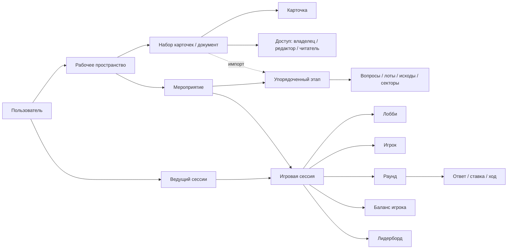
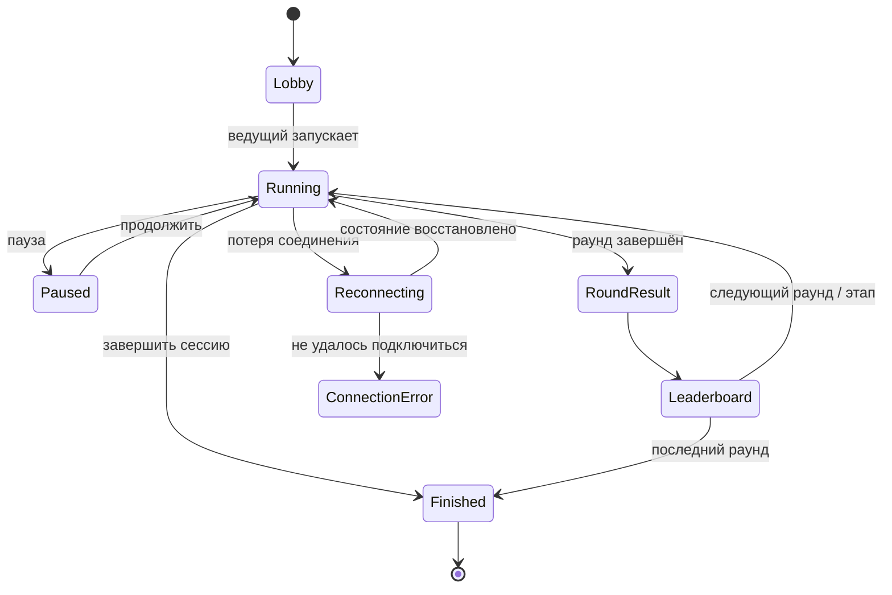

# 67 Cards — требования к проектированию интерфейсов в Figma

**Статус:** дизайн-бриф для проработки и согласования  
**Версия:** 1.0  
**Дата:** 21 октября 2026 года  
**Основные источники:** требования из `docs/stage_1`, проектные правила из `AGENTS.md`, текущий Nuxt-прототип из `frontend/app/pages/index.vue`

## 1. Назначение документа

Этот документ определяет, какие дизайн-файлы, пользовательские сценарии, экраны, состояния и компоненты необходимо подготовить в Figma для веб-приложения 67 Cards.

67 Cards состоит из двух существенно разных по контексту интерфейсов:

1. рабочая среда зарегистрированного пользователя, где создаются карточки и мероприятия;
2. игровая среда реального времени, где ведущий, игроки и общий экран одновременно видят разные представления одной игровой сессии.

Поэтому дизайн нельзя ограничивать набором отдельных красивых экранов. В Figma должны быть описаны:

- информационная архитектура;
- сквозные пользовательские потоки;
- адаптивное поведение;
- состояния в реальном времени;
- ограничения и ошибки;
- компоненты и дизайн-токены;
- правила передачи макетов в разработку.

## 2. Границы проектирования

### 2.1. Подтверждено требованиями

В дизайн обязательно входят:

- регистрация, авторизация, профиль, выход и удаление аккаунта;
- рабочее пространство пользователя;
- создание, переименование и удаление сущностей;
- наборы карточек и редактор карточки;
- текст, изображения, списки и таблицы на обеих сторонах карточки;
- предоставление доступа к наборам карточек и совместное редактирование;
- создание и редактирование мероприятия;
- упорядочивание этапов мероприятия;
- настройка динамического баланса;
- импорт карточек в «Викторину» и «Свою игру»;
- шесть типов этапов: «Викторина», «Своя игра», «Рынок прогнозов», «Аукцион», «Кейс», «Рулетка»;
- создание игровой сессии, код и QR-код подключения;
- лобби;
- управление сессией ведущим;
- игровой интерфейс участника;
- лидерборд;
- пауза, ручное изменение баллов и разрешение спорных ситуаций;
- блокировка уже принятого действия;
- потеря соединения, переподключение и восстановление состояния;
- итоговые результаты сессии.

### 2.2. Не подтверждено и требует отдельного решения

В текущем frontend-прототипе показаны «Каталог мероприятий», «Каталог карточек», «Пользователи», уведомления и публичные шаблоны. Эти разделы отсутствуют в формальных функциональных требованиях. Их можно исследовать в Figma как гипотезу, но нельзя включать в обязательный объём разработки до согласования.

Также формально не описаны:

- восстановление пароля и подтверждение электронной почты;
- история проведённых сессий и повторный просмотр результатов;
- команды и командный режим;
- чат, реакции, звук и голосовое управление;
- модератор как отдельная роль;
- платные тарифы и биллинг;
- публичный профиль пользователя;
- мобильное приложение как отдельный продукт.

## 3. Сущности и связи, которые должен отражать интерфейс



Ключевые смысловые различия:

- **мероприятие** — редактируемый шаблон сценария без игроков и текущих результатов;
- **игровая сессия** — конкретный запуск мероприятия с игроками, раундами, ставками и балансами;
- **этап** — часть мероприятия с одной игровой механикой;
- **раунд** — один завершённый вопрос, лот, прогноз или другое задание внутри этапа;
- **набор карточек** и **карточка** — самостоятельные материалы, которые могут быть импортированы в подходящий этап;
- **пользователь** имеет аккаунт, а **игрок** может участвовать как гость без регистрации.

Эти понятия нельзя смешивать в названиях экранов, навигации и кнопок. Например, кнопка «Запустить мероприятие» должна создавать игровую сессию, а не переводить шаблон мероприятия в состояние, где внутри него хранятся игроки.

## 4. Рекомендуемая организация Figma

Рекомендуется создать один Figma Project **67 Cards Product Design** и разместить в нём три обязательных рабочих файла. Отдельный архивный файл допустим, но не должен быть источником актуальных компонентов.

| Figma-файл | Назначение | Основные страницы |
|---|---|---|
| `00 — Foundations & UI Kit` | Единая визуальная система | Cover, Principles, Variables, Typography, Color, Grid, Icons, Components, Patterns, Motion, Accessibility, Changelog |
| `01 — Workspace & Authoring` | Аккаунт, рабочее пространство, карточки, мероприятия и настройка этапов | IA, Auth, Home, Card Sets, Card Editor, Sharing, Events, Event Builder, Stage Editors, Prototypes, Handoff |
| `02 — Live Session` | Лобби и синхронная игра для ведущего, игрока и общего экрана | Session Map, Join, Lobby, Host, Player, Public Display, Game Modes, Leaderboard, Recovery, Results, Prototypes, Handoff |

Дополнительно можно создать `99 — Exploration & Archive` для отклонённых концепций, старых версий и неподтверждённых функций. В рабочие файлы должны попадать только выбранные решения.

### 4.1. Правила организации каждого файла

- Первая страница — обложка с владельцем, статусом и датой последнего обновления.
- Страницы нумеруются и располагаются в порядке пользовательского пути.
- Фреймы именуются по схеме `Область / Сценарий / Экран / Состояние / Устройство`.
- У каждого основного потока есть схема переходов и кликабельный прототип.
- Готовые к разработке фреймы отделены от исследований и черновиков.
- Все повторяющиеся элементы строятся как компоненты с вариантами, а не копируются вручную.
- Все размеры, цвета, отступы, радиусы и типографика используют Variables/Styles.

## 5. Роли, контексты и целевые размеры

| Роль / контекст | Основное устройство | Базовые фреймы | Особенности |
|---|---|---|---|
| Гость, входящий по коду | смартфон | 360×800, проверка на 320×568 | Минимум действий, крупные поля и кнопки |
| Игрок в сессии | смартфон | 360×800, 390×844 | Mobile-first, управление одной рукой, таймер и баланс всегда различимы |
| Ведущий | ноутбук / desktop | 1280×800, 1440×900 | Плотный control room, список до 30 игроков, опасные действия защищены |
| Автор карточек и мероприятий | desktop / планшет | 1440×900, 1024×768 | Большие формы, таблицы, drag-and-drop, предпросмотр |
| Общий игровой экран | проектор / ТВ | 1920×1080, проверка 1366×768 | Читаемость с расстояния, минимум мелкого текста, без приватной информации |

Макеты должны учитывать до 30 игроков в одной комнате. Нельзя проверять лидерборд и список подключений только на примере 3–4 коротких имён.

## 6. Информационная архитектура

### 6.1. Зарегистрированная рабочая среда

```text
Главная
├── Мои наборы карточек
│   ├── Список наборов
│   ├── Редактор набора
│   ├── Редактор карточки
│   └── Доступ и совместная работа
├── Мои мероприятия
│   ├── Список мероприятий
│   ├── Конструктор мероприятия
│   ├── Настройка этапа
│   └── Запуск игровой сессии
├── Совместные материалы
└── Профиль и настройки аккаунта
```

«Рабочее пространство» следует использовать как контейнер для материалов пользователя, а не как четвёртый раздел, дублирующий «Мои мероприятия» и «Мои карточки». Окончательная навигационная модель должна быть проверена прототипом.

### 6.2. Игровая среда

```text
Ввод кода / сканирование QR
└── Выбор игрового имени
    └── Лобби
        └── Текущий этап
            ├── Текущий раунд
            ├── Раскрытие результата
            └── Лидерборд
                └── Следующий раунд / этап
                    └── Итоги сессии
```

На каждой точке пути отдельно проектируются три представления: ведущий, игрок, общий экран. Будущие этапы и их количество не показываются обычному игроку.

## 7. Файл `00 — Foundations & UI Kit`

### 7.1. Визуальные основы

Необходимо определить и оформить:

- логотип и минимальные размеры его использования;
- основную и дополнительную палитру;
- семантические цвета: успех, ошибка, предупреждение, информация, пауза, offline;
- высококонтрастные зелёный и красный для правильного и неправильного ответа;
- нейтральную шкалу фона, поверхностей, границ и текста;
- типографическую шкалу для mobile, desktop и общего экрана;
- сетки и систему отступов;
- радиусы, тени, уровни elevation;
- иконки игровых механик;
- стиль изображений и иллюстраций;
- правила для числовых показателей, таймеров, баланса и коэффициентов.

Текущий Nuxt-прототип использует тёмную тему, фиолетово-синие акценты и шрифт Inter. Это можно принять как исходное визуальное направление, но в Figma его необходимо оформить как осознанную систему и согласовать. Код прототипа сам по себе не является утверждённым бренд-гайдом.

### 7.2. Библиотека компонентов

Обязательные компоненты:

- кнопки: primary, secondary, ghost, danger, icon; все размеры и состояния;
- поля ввода, textarea, числовое поле, поиск, ввод кода комнаты;
- select, combobox, checkbox, radio, switch, slider;
- segmented control и tabs;
- загрузка и обрезка изображения;
- rich-text toolbar;
- карточка материала, карточка мероприятия, карточка этапа, карточка вопроса;
- строка списка и таблицы;
- avatar, player chip, role badge, permission badge;
- меню, popover, tooltip, dropdown;
- toast, inline alert, banner;
- modal, confirmation dialog, drawer;
- stepper и progress indicator;
- timer, countdown, progress ring;
- balance indicator и визуализация изменения баланса;
- leaderboard row и podium;
- connection status и reconnect overlay;
- QR-код с кодом комнаты;
- empty state, skeleton, error state;
- drag handle, drop zone и placeholder перестановки;
- pagination или виртуализированный список для больших наборов;
- breadcrumbs и основная навигация;
- live presence: курсор, аватар соавтора, блокировка редактируемого фрагмента;
- игровой action panel для ответа, ставки и повышения ставки.

Каждый интерактивный компонент должен иметь состояния:

- default;
- hover;
- focus-visible;
- active/pressed;
- disabled;
- loading;
- success;
- error;
- read-only, если применимо.

### 7.3. Составные паттерны

- создание/переименование/удаление сущности;
- предупреждение о несохранённых изменениях;
- опасное действие с подтверждением;
- выбор материала для импорта;
- настройка прав доступа;
- сохранение: сохраняется, сохранено, ошибка сохранения;
- пустой список и первый запуск;
- form validation;
- таймер с предупреждающими порогами;
- действие принято и заблокировано;
- пауза сессии;
- восстановление соединения;
- сервер отклонил действие;
- результаты раунда и изменение баланса.

### 7.4. Движение и анимация

В Figma необходимо описать длительность, easing и reduced-motion вариант для:

- смены вопроса и этапа;
- раскрытия правильного ответа;
- изменения позиции в лидерборде;
- начисления и списания баллов;
- вращения «Кейса» и «Рулетки»;
- броска кубика при штрафе лидера;
- открытия/закрытия рынка ставок;
- определения победителя аукциона;
- переподключения.

Анимация не должна скрывать фактический серверный результат или создавать впечатление, что результат определяется на клиенте.

## 8. Файл `01 — Workspace & Authoring`

### 8.1. Аккаунт

Спроектировать:

1. вход;
2. регистрацию;
3. профиль пользователя;
4. редактирование профиля;
5. меню аккаунта и выход;
6. инициирование удаления аккаунта;
7. подтверждение удаления с ясным перечислением затрагиваемых данных;
8. состояния неправильных данных, недоступности сервера и истёкшей сессии.

Восстановление пароля и подтверждение email разместить в зоне открытых вопросов, а не выдавать за утверждённую функцию.

### 8.2. Главная и рабочее пространство

Спроектировать:

- обзор последних наборов карточек и мероприятий;
- быстрые действия «Создать набор», «Создать мероприятие», «Войти по коду»;
- поиск по собственным и доступным материалам;
- раздельное отображение принадлежащих и предоставленных материалов;
- пустое состояние нового пользователя;
- состояние большого количества материалов;
- карточки сущностей с названием, владельцем, датой изменения, правами и контекстным меню;
- удаление, переименование и дублирование, если дублирование будет подтверждено.

### 8.3. Наборы карточек

Обязательные экраны и состояния:

- список наборов: grid/list, поиск, сортировка и фильтры;
- создание набора;
- пустой набор;
- набор с большим количеством карточек;
- превышение максимального количества карточек;
- просмотр набора с правом чтения;
- редактирование набора;
- переименование и удаление;
- предоставление и отзыв доступа;
- конфликт доступа или удалённый владельцем материал.

Карточка в списке должна показывать как минимум порядковый номер, краткий фрагмент лицевой и обратной стороны, наличие изображения и статус сохранения.

### 8.4. Редактор карточки

Для каждой карточки нужны:

- лицевая и обратная стороны;
- rich-text редактирование;
- списки и таблицы;
- добавление, замена, удаление и предпросмотр изображения;
- изменение порядка карточек;
- добавление, копирование и удаление карточки;
- быстрый переход между карточками;
- предпросмотр в виде учебной карточки;
- autosave и понятный статус сохранения;
- ограничения на формат и размер изображения;
- работа с длинным текстом и переполнением;
- поведение при одновременном редактировании.

### 8.5. Совместная работа и доступ

Минимальная модель прав в макетах:

- владелец;
- может редактировать;
- может просматривать.

Нужны:

- диалог предоставления доступа;
- список участников и их прав;
- изменение уровня доступа;
- отзыв доступа;
- ссылка, если общий доступ по ссылке будет подтверждён;
- presence соавторов;
- состояние, когда другой пользователь редактирует ту же карточку;
- read-only представление;
- потеря прав во время открытого экрана.

### 8.6. Список мероприятий

Спроектировать:

- список и карточку мероприятия;
- создание, переименование и удаление;
- черновик, готово к запуску и ошибка конфигурации;
- количество этапов и примерную длительность, если она вычисляется;
- запуск сессии из сохранённого мероприятия;
- подтверждение запуска и переход в лобби ведущего.

### 8.7. Конструктор мероприятия

Основной desktop-экран должен содержать:

- название и общие настройки мероприятия;
- упорядоченную последовательность этапов;
- добавление этапа из шести типов;
- drag-and-drop перестановку;
- дублирование и удаление этапа, если дублирование будет подтверждено;
- индикаторы неполной или ошибочной настройки;
- переход в настройки выбранного этапа;
- предпросмотр того, что увидят игрок и общий экран;
- настройки динамического баланса;
- сохранение и запуск сессии.

Необходимо спроектировать явную ошибку бизнес-правила F.3.9: «Рынок прогнозов» нельзя поставить до хотя бы одного разрешённого игрового этапа. Интерфейс должен не только блокировать действие, но и объяснять, как исправить структуру.

### 8.8. Общие настройки этапа

Для всех типов этапов предусмотреть:

- название этапа для ведущего;
- внутреннее описание;
- видимость правил и отдельных параметров для игроков;
- контент этапа;
- правила времени;
- правила начисления/списания баллов;
- предпросмотр;
- валидацию обязательных полей;
- сохранение черновика;
- удаление этапа.

### 8.9. «Викторина» — редактор

Спроектировать:

- список вопросов и изменение порядка;
- вопрос, правильный ответ и неправильные варианты;
- режим с вариантами и без вариантов;
- импорт карточек из выбранного набора;
- сопоставление «лицевая сторона → вопрос / обратная сторона → правильный ответ»;
- добавление неправильных вариантов после импорта;
- базовую стоимость;
- время на ответ;
- бонус за скорость;
- штраф за неправильный ответ;
- штраф или действие при отсутствии ответа;
- видимость настроек игрокам;
- предпросмотр вопроса для игрока и общего экрана.

### 8.10. «Своя игра» — редактор

Спроектировать:

- сетку категорий и вопросов разной стоимости;
- создание и переименование категории;
- редактирование вопроса, ответа и стоимости;
- импорт карточек;
- режим с вариантами и без вариантов;
- коэффициент для ответа без вариантов;
- выбор вопроса: ведущий, игроки по очереди или голосование;
- таймер голосования;
- штраф за неверный ответ самого быстрого игрока;
- предпросмотр игрового поля.

### 8.11. «Рынок прогнозов» — редактор

Спроектировать:

- описание события;
- два взаимоисключающих исхода;
- минимальную ставку: фиксированную или процент баланса;
- максимальную ставку;
- коэффициенты;
- время приёма ставок;
- возможность изменения ставки до закрытия;
- видимость банка и распределения ставок;
- видимость имён поставивших игроков;
- действие, если на правильный исход никто не поставил;
- предпросмотр открытого и закрытого рынка.

### 8.12. «Аукцион» — редактор

Спроектировать:

- список и порядок лотов;
- название, описание, фото, игровой эффект или награду лота;
- стартовую цену;
- минимальный шаг;
- линейное или экспоненциальное повышение шага;
- свободный или поочерёдный формат;
- завершение по времени или ведущим;
- добавочное время после последней ставки;
- действие при отсутствии ставок;
- способ разрешения ничьей/спора;
- предпросмотр лота.

### 8.13. «Кейс» — редактор

Спроектировать:

- список секторов;
- название, вес и эффект сектора;
- сумму весов и визуализацию вероятностей;
- стандартный набор секторов;
- ручную и автоматическую настройку эффекта;
- предупреждение о некорректной конфигурации;
- предпросмотр колеса/кейса и легенду эффектов.

### 8.14. «Рулетка» — редактор

Спроектировать:

- 37 секторов 0–36;
- цвет, вес и коэффициенты;
- типы доступных ставок;
- минимальную и максимальную ставку;
- время приёма ставок;
- восстановление равных весов по умолчанию;
- предупреждение об изменённых вероятностях;
- предпросмотр стола ставок и колеса.

### 8.15. Динамический баланс мероприятия

Отдельный экран или секция конструктора должна позволять:

- включать и отключать штрафы лидерам;
- задавать проценты для первых мест;
- включать и отключать бонусы отстающим;
- задавать проценты для последних мест;
- задавать порог отрыва лидера;
- задавать вероятность штрафного броска;
- задавать эффект выпадения;
- видеть понятный пример расчёта;
- получать предупреждения о противоречивых настройках.

## 9. Файл `02 — Live Session`

### 9.1. Карта состояний сессии



Для каждого перехода необходимо показать, кто инициирует действие и что в этот момент видят ведущий, игрок и общий экран.

### 9.2. Подключение игрока

Mobile-first поток:

1. ввод кода комнаты;
2. неверный, просроченный или несуществующий код;
3. ввод игрового имени;
4. проверка пустого, слишком длинного или уже занятого имени;
5. ожидание подключения;
6. успешный вход в лобби;
7. повторный вход и восстановление участника.

QR-код ведёт в тот же поток с уже заполненным кодом. Регистрация игроку не требуется.

### 9.3. Лобби

**Ведущий, desktop:**

- код и QR-код;
- список игроков и статус подключения;
- счётчик участников;
- управление нежелательным/дублирующимся участником, если это будет подтверждено;
- состояние «можно начинать»;
- запуск игры;
- закрытие входа, если функция будет подтверждена.

**Игрок, mobile:**

- своё игровое имя;
- подтверждение подключения;
- список или количество участников;
- ожидание ведущего;
- выход из комнаты;
- offline/reconnecting.

**Общий экран:**

- название мероприятия;
- код и QR-код;
- крупный список/счётчик подключившихся;
- состояние ожидания старта.

### 9.4. Control room ведущего

Постоянные области интерфейса:

- текущий этап и раунд;
- таймер и состояние приёма действий;
- превью общего экрана;
- список игроков, соединение и баланс;
- прогресс ответов без преждевременного раскрытия содержания;
- основные действия текущей механики;
- пауза;
- принудительное завершение раунда;
- переход дальше;
- ручное начисление/списание баллов с причиной;
- журнал последних игровых событий;
- опасное завершение всей сессии.

Ведущий не должен случайно нажать «завершить сессию» вместо «завершить раунд». Иерархия, расположение и подтверждения этих действий должны отличаться.

### 9.5. Общий экран

Общий экран проектируется отдельно от интерфейса ведущего. Он показывает участникам только разрешённую информацию:

- текущую механику;
- вопрос, лот, событие или колесо;
- таймер;
- количество принятых действий без раскрытия секретных данных;
- правильный ответ после серверного раскрытия;
- изменение баллов;
- лидерборд;
- паузу и техническое состояние;
- итоговые результаты.

На общий экран нельзя выводить правильный ответ до раскрытия, приватные настройки ведущего или лишние персональные данные.

### 9.6. Общая оболочка игрока

На всех этапах игрок должен стабильно видеть:

- своё имя;
- текущий баланс;
- таймер;
- состояние соединения;
- доступное действие;
- подтверждение принятия действия;
- блокировку изменения после фиксации;
- понятное состояние ожидания результата;
- причину отклонения действия сервером.

Количество и тип будущих этапов игроку не показываются.

### 9.7. Live-состояния по типам этапа

| Этап | Игрок, mobile | Ведущий, desktop | Общий экран |
|---|---|---|---|
| Викторина | вопрос, варианты или текстовый ответ, таймер, отправка, locked, результат | открыть вопрос, следить за количеством ответов, закрыть приём, раскрыть ответ | вопрос, таймер, число ответивших, затем правильный ответ и баллы |
| Своя игра | выбор/голосование, кнопка «Готов», состояние очереди, ответ | выбрать вопрос, увидеть порядок нажатий, принять/отклонить ответ, применить штраф | поле категорий, выбранный вопрос, кто отвечает, правильный ответ |
| Рынок прогнозов | выбрать исход и сумму, проверить лимиты, изменить до закрытия, увидеть locked | открыть/закрыть рынок, видеть распределение согласно настройкам, выбрать наступивший исход | событие, исходы, таймер, банк/распределение только если разрешено, итог |
| Аукцион | текущая цена, доступный баланс, допустимый следующий шаг, ставка, outbid, победа | открыть лот, управлять таймером, завершить, разрешить спор, подтвердить победителя | лот, цена, лидер торгов, таймер, победитель |
| Кейс | ожидание синхронного запуска, анимация, персональный или общий результат | запуск, контроль завершения, подтверждение применённого эффекта | колесо/кейс, серверный результат, эффект |
| Рулетка | стол ставок, фишки/сумма, ограничения, locked, результат | открыть/закрыть ставки, запустить, видеть расчёт выплат | стол/колесо, таймер, вращение, сектор и выплаты |

### 9.8. Лидерборд и результаты

Нужны варианты:

- после вопроса;
- после этапа;
- после ручной корректировки;
- после динамического бонуса или штрафа;
- финальный результат сессии;
- 30 игроков;
- ничья;
- длинные имена;
- игрок offline;
- анимированная смена позиций;
- reduced-motion вариант.

Необходимо явно показывать причину изменения баланса, а не только новое число.

### 9.9. Пауза, ручные баллы и спорные ситуации

Спроектировать:

- паузу, видимую всем участникам;
- продолжение игры;
- выбор игрока ведущим;
- начисление или списание баллов;
- ввод суммы и причины;
- подтверждение опасного изменения;
- успешное применение и отказ сервера;
- разрешение ничьей/спорной ставки аукциона;
- журнал изменений для ведущего.

### 9.10. Переподключение и восстановление

Обязательные состояния:

- краткий разрыв соединения;
- автоматическая попытка переподключения;
- интерфейс временно недоступного действия;
- успешное восстановление в текущем раунде;
- уже отправленный ответ/ставка остаётся зафиксированным;
- повторная команда не дублирует начисление;
- длительная ошибка с ручной повторной попыткой;
- завершённая комната;
- ведущий offline;
- отдельный игрок offline в списке ведущего.

## 10. Состояния, которые обязательны для всех ключевых экранов

Для каждого списка, редактора и игрового экрана проверить:

- loading и skeleton;
- пустое состояние;
- частично заполненные данные;
- нормальное состояние;
- длинный контент и переполнение;
- ошибка валидации;
- ошибка сервера;
- нет доступа;
- read-only;
- действие выполняется;
- действие успешно;
- действие отклонено;
- offline;
- reconnecting;
- stale data / данные обновились на сервере;
- disabled по бизнес-правилу с объяснением причины;
- подтверждение удаления или другого необратимого действия;
- работа только с клавиатуры;
- reduced motion.

## 11. Адаптивность и доступность

### 11.1. Mobile-first игрока

- Интерактивные цели — не меньше 44×44 px.
- Основное действие располагается в пределах удобной зоны большого пальца.
- Таймер, баланс и статус отправки не перекрываются экранной клавиатурой.
- Сценарий проверяется на ширине 320 px и при увеличении текста.
- Нельзя полагаться только на цвет: правильность ответа дублируется иконкой и текстом.
- При плохом соединении интерфейс не должен создавать ложное ощущение, что действие принято.

### 11.2. Desktop/tablet ведущего и редакторов

- Критические данные остаются видимыми без горизонтального скролла на базовых размерах.
- Панели могут сворачиваться, но основные управляющие действия не теряются.
- Drag-and-drop имеет клавиатурную альтернативу.
- Таблицы и длинные формы имеют ясную иерархию и закреплённые заголовки там, где это помогает.

### 11.3. Общий экран

- Проверить читаемость с расстояния и при слабом проекторе.
- Не использовать мелкие подписи как единственный способ понять состояние.
- Не показывать элементы, похожие на доступные кнопки, если экран не интерактивен.
- Анимации не должны вызывать дискомфорт; обязателен reduced-motion сценарий.

### 11.4. Общие критерии

- Контраст текста и интерактивных элементов — не ниже WCAG 2.2 AA.
- Фокус хорошо заметен.
- Статус не кодируется одним цветом.
- Иконки с неочевидным смыслом имеют подпись или tooltip.
- Ошибка связана с конкретным полем и содержит способ исправления.
- Русские строки проверяются на реальной длине, без сокращений-заглушек.

## 12. Обязательные кликабельные прототипы

### P1. Гостевой вход и восстановление

Ввод кода → игровое имя → лобби → потеря соединения → восстановление текущего состояния.

### P2. Создание набора и совместный доступ

Создать набор → добавить карточки → оформить текст/изображение → предоставить право редактирования → открыть read-only вариант.

### P3. Конструктор мероприятия

Создать мероприятие → добавить «Викторину» → импортировать карточки → добавить неправильные ответы → добавить «Рынок прогнозов» → изменить порядок → исправить ошибку F.3.9 → сохранить → запустить сессию.

### P4. Сквозная игровая сессия

Лобби → вопрос викторины → ответ игрока → раскрытие результата → лидерборд → рынок прогнозов → аукцион → ручная корректировка баллов → итог.

Прототип синхронно показывает ведущего, игрока и общий экран либо содержит явные ссылки между тремя дорожками.

### P5. Случайные механики и динамический баланс

Запуск «Кейса» или «Рулетки» → серверный результат → применение эффекта → бросок кубика лидеру → изменение лидерборда → reduced-motion вариант.

## 13. Трассировка требований к макетам

| Требования | Где отражаются в Figma |
|---|---|
| F.1.1–F.1.4 | `01`, страницы Auth и Account |
| F.2.1–F.2.6 | `01`, Card Sets, Card Editor, Sharing |
| F.3.1–F.3.9 | `01`, Event Builder, Stage Editors, Balance |
| F.4.1–F.4.14 | `01` Stage Editors и `02` Game Modes |
| F.5.1–F.5.9 | `02`, Join, Lobby, Host, Player, Public Display, Recovery |
| NF.1.2 | списки и лидерборды проверены на 30 игроках |
| NF.2.3, NF.2.6 | состояния до/после серверного раскрытия и серверного подтверждения |
| NF.3.1, NF.3.4 | `02`, Recovery |
| NF.4.1 | mobile-first макеты игрока |
| NF.4.2 | desktop/tablet макеты ведущего и редакторов |
| NF.4.3 | семантические success/error компоненты с высоким контрастом |

## 14. Очерёдность дизайн-работ

Это порядок производства макетов, а не сокращение конечного объёма.

1. **Смысловой фундамент:** сущности, роли, навигация, карта состояний сессии.
2. **Design system foundation:** токены, базовые компоненты, адаптивные сетки, accessibility.
3. **Основные материалы:** рабочее пространство, наборы карточек, редактор и права доступа.
4. **Конструктор мероприятия:** последовательность этапов, импорт и общие настройки.
5. **Викторина и «Своя игра»:** редакторы и полные live-потоки.
6. **Лобби и control room:** ведущий, игрок и общий экран, включая лидерборд.
7. **Рынок прогнозов и аукцион:** редакторы и live-потоки.
8. **Кейс и рулетка:** редакторы, ставки, анимации и результаты.
9. **Динамический баланс, пауза, ручные баллы и спорные ситуации.**
10. **Recovery и крайние состояния:** offline, reconnect, ошибки, большой объём данных.
11. **Финальная доступность, адаптивность, прототипирование и handoff.**

## 15. Definition of Done для дизайна

Экран или поток считается готовым к разработке, когда:

- он связан с конкретным требованием или согласованным продуктовым решением;
- показаны роли и целевые размеры;
- есть normal, loading, empty, error, disabled и permission-состояния там, где они применимы;
- компоненты взяты из библиотеки и используют токены;
- тексты не являются бессмысленными заглушками;
- описано адаптивное поведение;
- описаны интеракции, тайминги и переходы;
- опасные действия имеют защиту;
- серверно подтверждаемые действия визуально отличаются от локального ввода;
- проверена доступность и управление с клавиатуры;
- есть кликабельный happy path и минимум один error/recovery path;
- для разработчика указаны размеры, состояния, правила переполнения и данные, которые могут отсутствовать;
- дизайнер и разработчик провели совместный handoff-review.

## 16. Вопросы, которые нужно закрыть до финализации макетов

### Критические для архитектуры интерфейса

1. Что именно в F.3.9 считается допустимым этапом перед «Рынком прогнозов»: только «Викторина» и «Своя игра» или любой этап, начисляющий стартовые баллы?
2. Где показывается лидерборд после каждого вопроса: на общем экране, на устройствах игроков, у ведущего или везде?
3. Требуется ли отдельный режим общего экрана/проектора и как он подключается к сессии?
4. Какие права совместной работы поддерживаются кроме «просмотр» и «редактирование»? Возможна ли публичная ссылка?
5. Что происходит с мероприятиями, активными/завершёнными сессиями и общими материалами при удалении аккаунта?
6. Нужна ли история сессий и возможность открыть финальные результаты после завершения?

### Критические для игровых механик

7. Как определяется правильность свободного текстового ответа в «Викторине»: автоматически или ведущим?
8. Как ведущий подтверждает ответ в «Своей игре», и может ли следующий игрок ответить после ошибки первого?
9. Какие именно типы ставок доступны в «Рулетке» и можно ли делать несколько ставок за раунд?
10. «Кейс» вращается один раз для всех или отдельно для каждого игрока?
11. Как рассчитывается автоматический эффект «Кейса» относительно баланса игрока?
12. Кто и как выполняет бросок монеты или «камень-ножницы-бумага» при споре на аукционе?
13. Может ли ставка на рынке быть размещена на оба исхода одним игроком?
14. Что означает «настройка коэффициентов» рынка при пропорциональном распределении общего банка?
15. Какие параметры этапа можно скрывать от игроков и когда скрытые значения раскрываются?

### Для границ продукта

16. Нужны ли публичные каталоги мероприятий и карточек, показанные в текущем frontend-прототипе?
17. Нужен ли раздел «Пользователи» и для каких задач?
18. Нужны ли уведомления, восстановление пароля и подтверждение email?
19. Поддерживается ли только русский язык или нужно сразу проектировать переключение языка?
20. Должны ли мероприятия и наборы иметь обложки, теги, категории и публичный статус?

## 17. Известные несогласованности источников

- `docs/README.md` до этой работы не содержал описания документации.
- В ODT присутствуют редакторские комментарии и неформальные идеи, которых нет в экспортированном PDF. Их следует считать контекстом для обсуждения, но не формальными требованиями.
- Схема frontend одновременно упоминает Nuxt SSR и GitHub Pages. SSR требует серверного выполнения, а GitHub Pages обслуживает статические файлы; способ развёртывания нужно выбрать до проектирования зависящих от SSR функций.
- Схемы указывают несколько экземпляров Redis, хотя редакторский комментарий говорит, что на текущем этапе это не требуется.
- В F.5.4 выражение «главный экран» не определяет конкретное устройство или роль.
- В F.5.6 есть грамматический дубль, но смысл требования понятен: игрок может повышать ставку только в пределах шага и доступного баланса.
- Термины «документ» и «набор карточек» используются почти взаимозаменяемо. В интерфейсе следует выбрать один основной пользовательский термин и закрепить его в глоссарии.
- Текущий frontend показывает только демонстрационную главную страницу; большинство описанных сущностей и потоков ещё не реализованы в коде.

## 18. Итоговый набор артефактов

На выходе дизайн-работ должны быть:

- три структурированных Figma-файла;
- актуальная компонентная библиотека;
- карта сущностей и информационная архитектура;
- матрица ролей и устройств;
- макеты всех подтверждённых экранов и состояний;
- отдельные интерфейсы ведущего, игрока и общего экрана;
- адаптивные варианты;
- пять кликабельных прототипов;
- спецификация motion/reduced motion;
- accessibility-аннотации;
- таблица трассировки требований;
- список согласованных продуктовых решений по открытым вопросам;
- handoff-страницы для frontend-разработки.

Этот набор позволяет проектировать 67 Cards как целостную систему, а не как коллекцию несвязанных экранов, и учитывает масштаб одной комнаты до 30 игроков, параллельные игровые сессии и дальнейшее расширение набора игровых механик.
